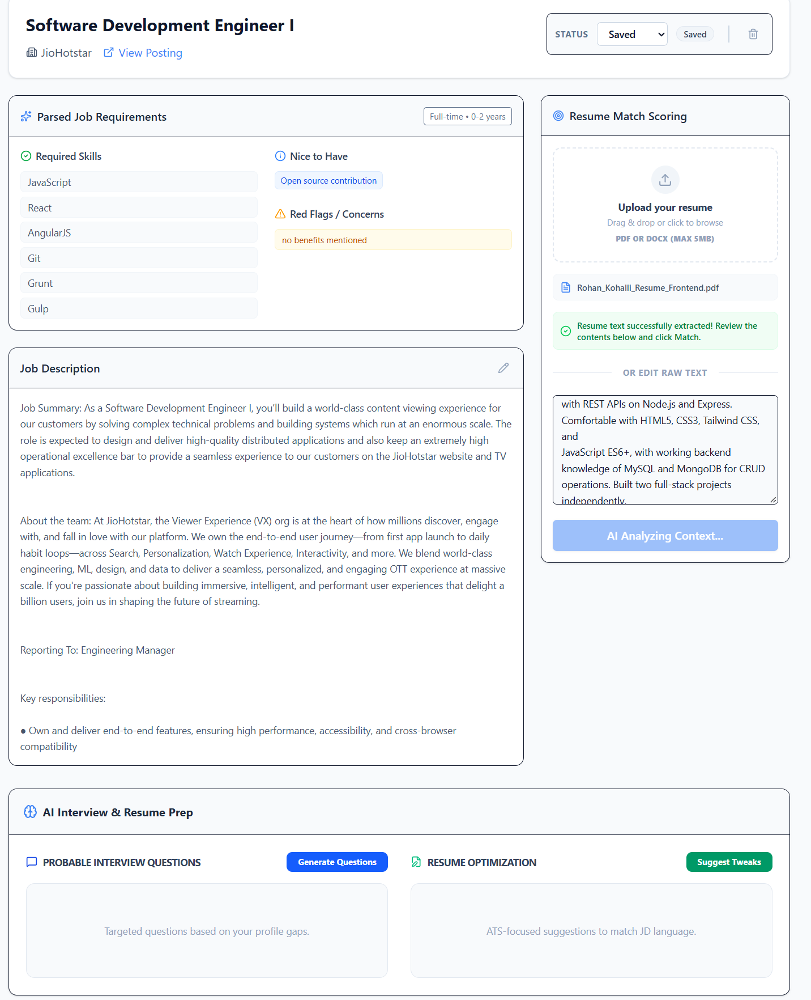

# Career Compass AI

<div align="center">

[](https://job-tracker-zeta-lovat.vercel.app/)
[](https://react.dev/)
[](https://tailwindcss.com/)
[](https://nodejs.org/)
[](https://expressjs.com/)
[](https://www.mysql.com/)
[](https://ai.google.dev/)

**A human-in-the-loop career intelligence & ATS application tracking pipeline.**  
*Ingest job postings from live URLs, match resumes with hybrid deterministic scoring, and generate tailored STAR interview coaching.*

[Explore Live Demo](https://job-tracker-zeta-lovat.vercel.app/) • [Features](#key-features) • [Architecture](#architecture--design-principles) • [Quickstart](#setup) • [API Reference](#api-endpoints)

---



</div>

---

## Overview

Most job tracking tools are either static spreadsheets or black-box automated spam bots. **Career Compass AI** introduces a **human-in-the-loop** workflow:
- **Instant Ingestion:** Scrapes live job descriptions from URLs via Cheerio and parses key criteria using Google Gemini.
- **Hybrid ATS Scoring:** Combines deterministic exact-token keyword scoring with LLM-powered contextual evaluation (avoiding pure hallucination).
- **Targeted STAR Prep:** Automatically constructs personalized behavioral and architectural interview questions tailored specifically to the delta between your resume and the target JD.
- **Privacy-First Ingestion:** In-memory document parsing for PDF and DOCX files without persisting sensitive documents to disk.

---

## Key Features

- 🎯 **Pipeline Management** — Track applications across lifecycle stages (`saved` → `applied` → `interviewing` → `offered` → `rejected`).
- 🔗 **Smart URL Scraping** — Paste any public job posting URL; the backend strips boilerplate, extracts metadata, and seeds the job profile.
- ⚡ **Automated JD Analysis** — Gemini extracts required hard skills, soft skills, seniority indicators, culture flags, and role responsibilities.
- 📊 **Hybrid Resume Matcher** — Deterministic keyword frequency matching + semantic LLM evaluation with itemized strengths and missing prerequisites.
- 🎙️ **Tailored Interview Coach** — On-demand STAR (Situation, Task, Action, Result) interview questions, situational talking points, and answer outlines.
- 🔍 **Live Job Discovery** — Integrated multi-engine search (Adzuna + SerpApi fallback) with a 7-day TTL caching layer in MySQL.

---

## Architecture & Design Principles

```
Job-Tracker/
├── backend/
│   ├── src/
│   │   ├── config/                # Database pool & Sequelize config
│   │   ├── controllers/           # HTTP controllers & validation mapping
│   │   ├── middleware/            # JWT authentication & rate limiters
│   │   ├── models/                # Sequelize ORM schema definitions & associations
│   │   ├── routes/                # Modular REST route handlers
│   │   ├── services/              # Business logic, document parsers, & Gemini LLM integrations
│   │   ├── validators/            # Express-validator input schemas
│   │   └── index.js               # Express application entry point
│   ├── .env.example
│   └── package.json
└── frontend/
    ├── public/                    # Static assets, sitemap.xml, robots.txt, preview images
    ├── src/
    │   ├── api/                   # Typed Axios API clients with auto-token refresh
    │   ├── components/            # Reusable UI cards, badges, dashboards, and layouts
    │   ├── context/               # Authentication and session state providers
    │   ├── pages/                 # Full application pages (Landing, Dashboard, Detail, Add, Search)
    │   ├── App.jsx
    │   └── main.jsx
    ├── package.json
    └── vite.config.js
```

### Layered Separation of Concerns
1. **Routes → Controllers → Services:** Controllers never handle business logic or database queries directly.
2. **Deterministic vs. Generative Isolation:** Exact keyword matching and document parsing run through pure deterministic algorithms before passing structured contexts to Google Gemini.
3. **Resilient Session Auth:** Dual JWT architecture with short-lived access tokens and secure HTTP-only refresh tokens.

---

## Tech Stack

| Domain | Technology |
|---|---|
| **Frontend** | React 19, Vite, Tailwind CSS v4, Lucide React, React Router v7 |
| **Backend** | Node.js (ESM), Express 5, Sequelize ORM |
| **Database** | MySQL |
| **AI / LLM** | Google Gemini Flash via `@google/genai` |
| **Document Processing** | `unpdf` (PDF streaming/parsing), `mammoth` (DOCX parsing) |
| **Web Scraping** | `cheerio`, `axios` |
| **Deployment** | Vercel (Frontend & Serverless deployment ready) |

---

## Setup

### Prerequisites
- Node.js >= 18
- MySQL Server (Local or Cloud instance e.g., PlanetScale, Aiven, Railway)
- Google Gemini API Key ([Google AI Studio](https://aistudio.google.com/))

### 1. Database Setup

```bash
mysql -u root -p -e "CREATE DATABASE jobhunt;"
```

### 2. Backend Setup

```bash
cd backend
cp .env.example .env     # Configure your database credentials & Gemini API Key
npm install
npm run dev              # Starts Express server on http://localhost:8000
```

### 3. Frontend Setup

```bash
cd frontend
cp .env.example .env     # Points VITE_API_URL to http://localhost:8000/api
npm install
npm run dev              # Launches Vite dev server on http://localhost:5173
```

---

## Environment Variables

### Backend (`backend/.env`)

| Variable | Required | Default / Example | Description |
| --- | --- | --- | --- |
| `PORT` | No | `8000` | Port for Express API server |
| `FRONTEND_URL` | Yes | `http://localhost:5173` | Allowed CORS origin & cookie domain |
| `DB_HOST` | Yes | `localhost` | MySQL database host |
| `DB_PORT` | No | `3306` | MySQL database port |
| `DB_USER` | Yes | `root` | MySQL database username |
| `DB_PASSWORD` | Yes | `""` | MySQL database password |
| `DB_NAME` | Yes | `jobhunt` | MySQL database name |
| `JWT_ACCESS_SECRET` | Yes | `your_access_token_secret` | Secret key for signing access JWTs |
| `JWT_REFRESH_SECRET` | Yes | `your_refresh_token_secret` | Secret key for signing refresh JWTs |
| `ACCESS_TOKEN_EXPIRES_IN` | No | `15m` | Token expiry duration for access tokens |
| `REFRESH_TOKEN_EXPIRES_IN` | No | `7d` | Token expiry duration for refresh tokens |
| `GEMINI_API_KEY` | Yes | `your_gemini_api_key_here` | Google Gemini API key for analysis & coaching |
| `ADZUNA_APP_ID` | No | `""` | Optional Adzuna App ID for job search |
| `ADZUNA_APP_KEY` | No | `""` | Optional Adzuna App Key for job search |
| `SERPAPI_KEY` | No | `""` | Optional SerpApi key for search fallback |

### Frontend (`frontend/.env`)

| Variable | Required | Default / Example | Description |
| --- | --- | --- | --- |
| `VITE_API_URL` | Yes | `http://localhost:8000/api` | Base URL for backend REST API endpoints |

---

## API Endpoints

### Authentication (`/api/users`)
- `POST /api/users/register` — Register a new user account
- `POST /api/users/login` — Authenticate and receive access + refresh token
- `POST /api/users/refresh` — Refresh expired access token
- `POST /api/users/logout` — Revoke session cookies
- `GET /api/users/profile` — Fetch authenticated user profile

### Job Pipeline (`/api/jobs`)
- `GET /api/jobs` — List all tracked jobs with filtering and pagination
- `POST /api/jobs` — Create a new job manually or from scraped payload
- `GET /api/jobs/:id` — Retrieve full job details, match score, and prep status
- `PATCH /api/jobs/:id/status` — Transition application status
- `DELETE /api/jobs/:id` — Remove job from pipeline
- `POST /api/jobs/capture` — Ingest and scrape job data from target URL
- `POST /api/jobs/parse` — Parse unstructured raw job description text via Gemini

### Intelligence & Coaching (`/api/jobs/:id`)
- `POST /api/jobs/:id/analyze` — Run Gemini JD entity extraction & requirement analysis
- `POST /api/jobs/:id/score` — Ingest resume file and compute hybrid ATS match score
- `POST /api/jobs/:id/prep` — Generate tailored STAR interview questions and talking points

---

## License

This project is licensed under the [MIT License](LICENSE).
